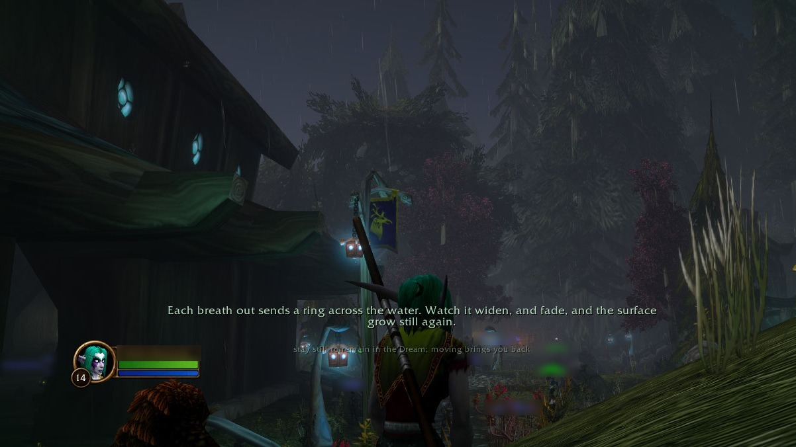

<p align="center"></p>

<h1 align="center"> Shan'do</h1>
<p align="center"><i>A night elf spirit guide for quiet moments.</i></p>
<p align="center"><b><a href="https://rainbowpusheenthe3rd.github.io/shando/">Listen to it →</a></b></p>

<p align="center"></p>

### A night elf spirit guide for the quiet moments: she breathes with you, greets the old places, and teaches you the plants you gather.

A free addon for **World of Warcraft: Forever** (Classic+; interface 16001, also 120105), with around 1,100 lines in one
voiced night elf voice. Open source, no adverts.

## What you get

- **A companion, not a quest tracker.** She speaks at quiet moments only: never in combat or dungeons, and never
  closer than 45 seconds apart (adjustable in the settings).
- **Rarely the same thing twice.** She always says the line you've heard least, so you hear every line of a kind
  before any repeats. If you do run through a kind, it waits longer before it speaks again.
- **A breath when you stop.** Stand still outdoors for a minute and a half and she offers a breath, then a wind
  that breathes with you, the out-breath longer than the in-breath. Moving ends it.
- **Botany as you gather.** Every herb belongs to a real plant family: kelp, moss, lichen, mushrooms, grasses,
  lilies, lotuses, the daisy family, roots, thorns or flowering plants in general. Gather a family and she teaches
  it in three levels, opening at 1, 10 and 30 gathers: what you can see, how it lives, and where it sits in the long
  history of plants. Every herb, rare find and seed also has its own lines.
- **The places that matter.** The first visit to each of 25 sacred or storied places, from Shadowglen to
  Winterspring, gets a soft swell and one line. Felwood is *wounded, not wicked*.
- **Rituals you choose.** Shadowmeld meditation, /sleep in a barrow den, /kneel or /pray under the moon, and
  **/emerald dream**: two guided meditations of about ten minutes each that end beside a pond of frogs.
- **The good you do, noticed.** Healing or blessing a stranger (not yourself) gets a bell and a word. Groups,
  trainers, levels, new forms and finished quests each have their own lines.
- **Gentle on hard days.** One word when you fall, one about rest after several falls, then quiet. Late at night,
  and after a long day's road, a word of care.
- **Real places to rest.** Inns play a Japanese garden by day and a hearth fire by night, built from real field
  recordings that never loop the same way twice.

## Why

The world of Azeroth is full of quiet beauty that the game itself never points at: moonwells in the rain, the
barrow dens, the herbs you pull up by the hundred without a second look. Night elves are the race of the druids, the
Sentinels and Elune's priestesses, and the game gives them no voice for any of it. Shan'do is that voice: a
druid's spirit who notices the world with you, keeps you company in the slow parts, and leaves you a little calmer
than you were.

## Download

1. Get **[the latest release](https://github.com/rainbowpusheenthe3rd/shando/releases/latest)** (the
   `Shando-vX.Y.Z.zip` under Assets), or install it from CurseForge.
2. Unzip it into `World of Warcraft\_<flavour>_\Interface\AddOns`, so you have `AddOns\Shando\Shando.toc`.
3. Restart the game fully the first time, so its saved settings are created. Listen to some of her first:
   **[the sound page](https://rainbowpusheenthe3rd.github.io/shando/)**.

| Command | |
|---|---|
| `/shando` | rest her, or call her back |
| `/shando quieter` | speak less often (down to a quarter) |
| `/shando nearer` | speak more often (up to four times) |
| `/emerald dream` | a guided meditation (choose which in the options) |
| `/shando help` | the in-game guide |
| `/shando options` | the settings: herbs, skinning, beds and more |

The minimap button sits at half opacity: left-click for the guide, right-click to rest her, drag to move it.

<details>
<summary><b>Research, credits and development</b></summary>

## The research

[RESEARCH.md](RESEARCH.md) holds every design choice with its evidence: breathing, nature, savouring, kindness, self-compassion, belonging, grief, sound. DOIs were checked; effect sizes are reported with their caveats, and ideas that failed replication are listed as dropped.

## Spoilers

Every line is in `Shando/Lines.lua` and `Shando/HerbLines.lua`. If you'd like to be surprised, don't open it.

## Also

**Herbalore**, the herb voices, is now part of Shan'do (switch it off in the settings). Its own repo stays up for anyone who wants herbs alone: [github.com/rainbowpusheenthe3rd/herbalore](https://github.com/rainbowpusheenthe3rd/herbalore)

## Credits

The voice is AI-generated with [VoxCPM2](https://huggingface.co/openbmb/VoxCPM2) (Apache-2.0): designed once from a
description and used for every line, with a soft moonwell reverb. The soundscapes are real field recordings, cut, looped and levelled for the game (changes made); the chime and the kindness bell were generated with [MOSS-SoundEffect](https://github.com/OpenMOSS/MOSS-TTS) (Apache-2.0).

| File | From | Licence of the file |
|---|---|---|
| `sfx/dream.mp3, sfx/dream/ (barrow den)` | [Bourne woods rain 2020-05-10 0757](https://commons.wikimedia.org/wiki/File:Bourne_woods_rain_2020-05-10_0757.mp3) by Robert EA Harvey, CC BY-SA 4.0<br>[Light Rain Distant Thunder July 5th 2016](https://freesound.org/people/kvgarlic/sounds/349454/) by kvgarlic, CC0 | CC BY-SA |
| `sfx/vigil.mp3 (vigil)` | [Nature sounds ambience in a Dordogne pond](https://commons.wikimedia.org/wiki/File:Nature_sounds_ambience_in_a_Dordogne_pond.ogg) by Glaneur de sons, CC BY 3.0 | as its sources |
| `sfx/inn_day.mp3, sfx/inn_day/ (an inn by day)` | [Water on Rocks](https://commons.wikimedia.org/wiki/File:Water_on_Rocks.ogg) by Dsw4, CC BY 3.0<br>[Suikinkutsu recording](https://commons.wikimedia.org/wiki/File:Suikinkutsu_recording.ogg) by Torsodog, from Waterharpsound.ogg by Shizhao, CC BY-SA 3.0<br>[Suikinkutsu-LS100109 and -LS100112](https://commons.wikimedia.org/wiki/File:Suikinkutsu-LS100109.ogg) by Fg2, public domain | CC BY-SA |
| `sfx/swell.mp3 (a place)` | [Suikinkutsu recording](https://commons.wikimedia.org/wiki/File:Suikinkutsu_recording.ogg) by Torsodog, from Waterharpsound.ogg by Shizhao, CC BY-SA 3.0 | CC BY-SA |
| `sfx/inn_night.mp3, sfx/inn_night/ (an inn at night)` | [Campfire sound ambience](https://commons.wikimedia.org/wiki/File:Campfire_sound_ambience.ogg) by Glaneur de sons, CC BY 3.0<br>[Dry grass burning in open fireplace](https://commons.wikimedia.org/wiki/File:Dry_grass_burning_in_open_fireplace.ogg) by ezwa, public domain | as its sources |
| `sfx/meld.mp3 (shadowmeld at night)` | [Summer Night in the Swamp: Authentic Frogs & Crickets Soundscape](https://freesound.org/people/hafijur_rahman/sounds/853607/) by hafijur_rahman, CC0 | as its sources |
| `sfx/meld_day.mp3 (shadowmeld by day)` | [River Stream, Lake of Glacier, Lago del Desierto](https://freesound.org/people/Singular_Estudio/sounds/510232/) by Singular_Estudio, CC0 | as its sources |
| `sfx/windbreath.mp3 (the breathing wind, shaped to a slow breath)` | [Wind, Mistral gusts, dry grass](https://freesound.org/people/silencyo/sounds/81798/) by silencyo, CC0 | as its sources |
| `sfx/wisp.mp3 (the wisp)` | [crickets](https://freesound.org/people/zerrofs/sounds/118419/) by zerrofs, CC0 | as its sources |

The icon and the banner are
drawn in code. Not affiliated with or endorsed by Blizzard Entertainment; World of Warcraft and its names belong to
Blizzard. Code and the voice files are MIT licensed; the sound files keep their sources' licences, in the table above.

## Talks to

Shares the herb session with Herbalore (`HerbaloreSession`, `ShandoGap`).

## Releasing

```sh
git tag -a v1.2.0 -m "1.2.0" && git push origin v1.2.0      # builds the zip, makes the GitHub Release
```

CurseForge uploads are by hand for now, from the zip on the GitHub Release; nothing uploads there automatically.

</details>

<p align="center"></p>
